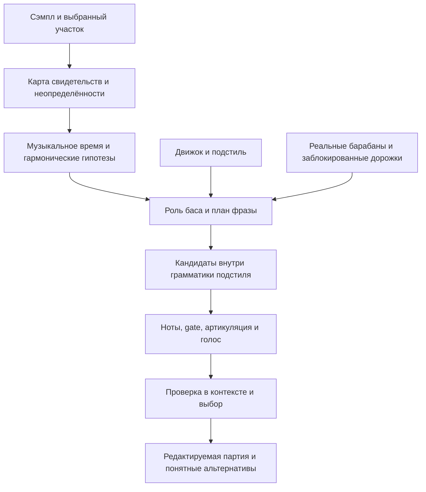

# Бас под произвольный сэмпл: исследование и программа качества HPDG

Дата: 1 ноября 2026. Статус: исследовательский проект, без изменений реализации.

## 1. Вывод и границы работы

Для профессионального результата HPDG должен решать задачу **аранжировки баса в контексте**, а не только выбирать ноты из определённой тональности. Порядок решений: нужен ли дополнительный бас → какую роль он выполняет → как развивается фраза → где звучат атаки и паузы → какие ноты и переходы уместны → какой инструмент и артикуляция реализуют замысел → как всё звучит вместе с сэмплом и барабанами.

«Под любой сэмпл» означает широкую проверенную область применения и разумное поведение за её пределами. Из мелодии без аккордов невозможно однозначно восстановить единственную задуманную гармонию. Из зашумлённого полного микса нельзя гарантированно извлечь точные MIDI-длины всех басовых нот. Качественная система сохраняет несколько объяснений, выбирает устойчивый вариант и позволяет человеку уточнить намерение.

**Предлагаемая цель AAA:** пользователь часто получает пригодную партию с первой генерации, слышит осмысленную связь с сэмплом и выбранным подстилем, редко исправляет серьёзные ошибки и может предсказуемо управлять результатом. Это рабочее определение качества продукта, а не существующий стандарт сертификации.

Работа охватывает все **7 движков и 36 существующих подстилей**, включая скрытые Rap и Drill. Guide Breakbeat / Copy Break и воспроизведение извлечённой драм-партии исключены. DnB Breakbeat остаётся в перечне как самостоятельный генеративный подстиль.

### Как читать утверждения

- **Наблюдение:** проверено чтением текущего репозитория или явно названного прежнего отчёта.
- **Исследовательский результат:** опубликован авторами указанной работы; переносимость на HPDG отдельно не доказана.
- **Предложение:** архитектура, музыкальная гипотеза или критерий будущего эксперимента.

Новые аудиоизмерения, прослушивания корпуса, обучение моделей и тесты генератора в этой работе не проводились. Приведённые ниже цели качества ещё не достигнуты и требуют проверки.

## 2. Что уже есть и где находятся ограничения

Наблюдения относятся к рабочей копии на указанную дату. В ней есть незакоммиченные изменения; для воспроизводимого эксперимента будущему агенту потребуется зафиксировать точный снимок исходников, настроек и моделей.

| Участок | Наблюдение | Следствие для исследования |
|---|---|---|
| Общий контекст | `SampleAwareGenerationContext` уже несёт признаки, confidence, гармонию, ноты, настроение и степень влияния | Развивать существующий контракт, прежде чем создавать параллельную систему анализа |
| Гармония | Есть глобальная тональность, chroma, tuning, басовые сегменты и нотные линии | Это ещё не временная модель аккордов, обращений и конкурирующих гармонических объяснений |
| Trap | Значимая часть тональной адаптации находится после генерации: sample key, follower, отдельный composer | Проверить планирование локальной гармонии до выбора ритма; сохранить собственную грамматику подстиля |
| Boom Bap | Басовый генератор имеет собственные архетипы и планы корней; затем применяется общая адаптация | Отделить архетип баса от названия подстиля и от гармонии конкретного сэмпла |
| DnB | Есть внутренний `DnBSampleLens`: локальные корни и отношения с басовыми событиями сэмпла | Проверять уже работающую логику, точность временной карты, уверенность и повторные атаки одной высоты |
| Techno | Есть внутренний `TechnoSampleLens`, в том числе агрегация корней по тактам | Проверить смены гармонии внутри такта и различение pitched bass / kick rumble |
| Atmospheric | В прочитанном пути `writeBass` передаёт key/scale, но не локальную гармоническую карту; тональная постобработка возвращает управление рано | Проверить весь маршрут и измерить пользу локальной гармонии: это приоритетный кандидат на пробел покрытия |
| Rap | `applySampleAwareRapFlavor` использует акценты, onset и low-energy контекст | Это свидетельство влияния сэмпла на groove, но не доказательство полноценного гармонического басового планирования |
| Drill | Есть contextual hints и отдельный движок | Проверить, доходит ли локальная гармония до баса; не считать наличие hints доказательством её использования |

Основные места для последующего чтения: `Source/Analysis/SampleAwareGenerationContext.h`, `SampleHarmonyAnalyzer.h`, `SampleLineTranscriber.h`; `Source/Plugin/PluginProcessor.cpp`; `Source/Engine/SampleBassFollower.cpp`, `SampleBassLineComposer.cpp`; басовые генераторы внутри `BoomBap`, `DnB`, `Techno`, `Atmospheric`, а также `TrapEngine.cpp`, `RapEngine.cpp`, `DrillEngine.cpp`.

Часть старых формулировок в `docs/ROADMAP_UPDATE.md` описывает прежнее состояние. Например, общее утверждение о неиспользовании hints нельзя автоматически переносить на нынешние Rap/Drill. Фактический маршрут каждого поля нужно проверять в текущем коде.

Исторические отчёты дают отправные точки, но не универсальную оценку:

- `docs/audit/SAMPLE_ANALYSIS_STAGE.md` показывает необходимость калибровки тональной уверенности: большое значение confidence само по себе ещё не гарантирует правильную тональность.
- `docs/audit/DARK_TRAP_2026_11.md` описывает ограниченный корпус из 11 файлов и трудности автоматического измерения басовых атак после разделения источников.
- `docs/audit/DARK_TRAP_SAMPLE_GUIDANCE.md` подтверждает отдельные регрессии DarkTrap, включая работу pickup-цепочек и слабого guidance. Это узкие проверки, а не доказательство качества на произвольной музыке.

## 3. Научная основа: что полезно перенести, а что нельзя обещать

### 3.1. Сопровождение по аудио возможно, но аудиогенерация не равна MIDI-планировщику

Pasini, Grachten и Lattner исследуют генерацию басового аудиосопровождения через latent diffusion с условием по остальному миксу. Работа поддерживает саму постановку «слушать контекст и создавать совместимый бас». Авторы отдельно отмечают отсутствие точного пользовательского контроля над нотами. Для HPDG это аргумент в пользу исследовательской ветки и возможного учителя/референса, а не готовая замена редактируемому MIDI и жанровым движкам. [Bass Accompaniment Generation via Latent Diffusion, 2024](https://arxiv.org/html/2402.01412v1).

JASCO исследует сочетание глобальных и локальных условий, включая символические и аудиоданные. Полезный принцип для HPDG: намерение пользователя, гармонические события и звук сэмпла должны быть разными согласованными условиями. Возможности генерации полного аудио не доказывают точность наших нот, задержку VST или сохранение идентичности подстиля. [JASCO, 2024](https://arxiv.org/abs/2406.10970).

### 3.2. Гармонический контекст важен, но исследования имеют область применимости

В сравнении chord-conditioned генераторов Salem, Shokri и Devaney гармоническое условие улучшало ряд показателей нотного содержания; особенно удачным оказался вариант bass-first. Эксперимент выполнен на упрощённых фразах классического фортепианного корпуса TAVERN, с сокращёнными нотными линиями и удалёнными обращениями аккордов. Он обосновывает проверку гармонического планирования, но не доказывает, что та же архитектура автоматически даст лучший DarkTrap, Acid или WestCoast. [Chord-conditioned Melody and Bass Generation, 2025](https://arxiv.org/html/2511.08755v1).

### 3.3. Анализ нужно разложить на проверяемые задачи

Разделение источников, распознавание нот и понимание гармонии — разные задачи. HT Demucs полезен как кандидат для получения отдельного басового сигнала; его выход следует считать измерением с ошибками. Вторая гармоника, утечка бочки и изменение громкости после sidechain способны вводить последующие алгоритмы в заблуждение. Сам факт хорошей separation-метрики не удостоверяет корректность MIDI-атак. [Hybrid Transformers for Music Source Separation, 2022](https://arxiv.org/abs/2211.08553). Последнее предложение о MIDI является выводом для нашего каскада, а не заявленным результатом статьи.

Basic Pitch — кандидат для нотной транскрипции; официальный проект указывает, что лучший режим — один инструмент за раз. CREPE решает задачу монофонической основной частоты. Ни один из этих интерфейсов не следует принимать за универсальный детектор «корня аккорда полного микса». [Basic Pitch: статья](https://arxiv.org/abs/2203.09893), [официальный проект](https://github.com/spotify/basic-pitch), [CREPE](https://arxiv.org/abs/1802.06182).

Для beat/downbeat анализа имеет смысл сравнить текущую DSP-базу с Beat This!, а для совместного метрического и структурного анализа — с All-In-One. Измерения на полных песнях нельзя без проверки переносить на двухтактовые лупы, затакты и неметрические текстуры. [Beat This!: официальный проект](https://github.com/CPJKU/beat_this), [All-In-One, 2023](https://arxiv.org/abs/2307.16425).

На дату работы есть и более свежие кандидаты: Harmonica — препринт сентября 2026 о компактной инструментально независимой транскрипции. Его можно включить в исследовательское сравнение после проверки доступности модели. Это не основание объявлять решённой задачу анализа баса внутри любого микса или обещать производительность на пользовательском Windows-компьютере. [Harmonica, 2026](https://arxiv.org/abs/2609.04640).

### 3.4. Уверенность должна предсказывать риск ошибки

Число от детектора не является вероятностью правильного решения без калибровки. Работа Guo et al. даёт основания проверять reliability и простые методы калибровки, включая temperature scaling для подходящих моделей. Для HPDG нужны отдельные проверки pitch, onset, bass-presence, beat-phase и гармонии, а не один общий confidence на весь сэмпл. [On Calibration of Modern Neural Networks, 2017](https://arxiv.org/abs/1706.04599).

### 3.5. Больше событий не означает лучший groove

Witek et al. обнаружили в своём эксперименте нелинейную связь синкопирования с удовольствием и желанием двигаться. Из этого нельзя вывести универсальную «правильную плотность» для всех стилей. Практический вывод для исследования HPDG: измерять контекст и слушательское предпочтение, не оптимизировать количество нот или rolls само по себе. [Syncopation, Body-Movement and Pleasure in Groove Music, 2014](https://doi.org/10.1371/journal.pone.0094446).

## 4. Что анализатор должен сообщать генератору

Предлагается расширять общий контекст постепенно, сохраняя работоспособную текущую базу. Генератору нужна карта свидетельств, а не команда «поставь бас на каждом пике».

| Слой | Нужная информация | Ключевая неопределённость |
|---|---|---|
| Происхождение | Файл, выбранный участок, channel layout, реальная длина, trim, playback offset, transpose/stretch | Совпадает ли анализ с реально звучащим материалом |
| Музыкальное время | Несколько гипотез tempo, beat/downbeat, meter, local warp, pickup, loop seam | 70/140, неверная первая доля, плавающий темп |
| Гармония | Локальные chroma, tuning, вероятные аккорды/корни/обращения, pedal, границы изменений | Мелодия не определяет аккорд; низшая нота не всегда root |
| Источники | Вероятность уже существующего баса, бочки, низкого инструмента, вокала, шумового хвоста | Rumble и низкий piano не равны новому басовому голосу |
| События | Атаки, удержания, повторные атаки одной высоты, pitch trajectory, offset с неопределённостью | Slide, reattack и восстановление после ducking различаются |
| Занятость | Энергия и гармоническая активность по времени и полосам, маскирование, хвосты | Спектральное место не сводится к «есть/нет низких частот» |
| Форма | Повторяющиеся мотивы, фразы, переходы, длительные изменения энергии | Двухтактовый loop не раскрывает форму полной песни |
| Надёжность | Конкурирующие объяснения, качество источника, поддержка разных признаков, OOD | Несколько моделей на одинаковых ошибочных данных не дают независимого подтверждения |

Необходимо различать четыре понятия: **тональность**, **корень аккорда**, **фактически звучащая нижняя нота**, **нота нового баса**. Они могут совпадать, но это не обязательное условие. Для C/E нижняя E не превращает аккорд в E major. В jazz-сэмпле возможны неполные/rootless voicings. В trap возможен намеренный pedal под меняющейся верхней фактурой.

Настройку строя следует оценивать устойчиво во времени. Wow/flutter или вибрато не должны заставлять новую 808 лихорадочно менять настройку на каждом кадре. При конфликте гипотез нужны осторожная партия и возможность вручную задать tonic/аккорды, а не фиктивная высокая уверенность.

Нужен анализ в нескольких временных масштабах: короткий для атак, более длинный для низкого pitch и гармонии, фразовый для устойчивости гипотез. Это физически существенно: период 40 Hz равен 25 ms, а интервал 1/64 при 180 BPM — около 20,8 ms. На таком коротком фрагменте нельзя требовать независимой надёжной оценки fundamental без дополнительного контекста. Спектральный максимум может принадлежать гармонике, а форма pitch-envelope — атаке 808, поэтому простой peak-picking не является достаточным определением её музыкальной ноты.

### 4.1. Время: секунды сначала, музыкальная интерпретация отдельно

Физическая ось сэмпла — секунды относительно реально выбранного участка. Её длина определяется регионом, а не последней найденной нотой. Иначе тишина в конце и длинный release ломают период повторения.

Поверх физического времени строятся музыкальные координаты. В 4/4 один такт при 90 BPM длится столько же, сколько два такта при 180 BPM: около 2,667 секунды. Это эквивалентность временного масштаба, а не разрешение незаметно менять число тактов проекта. Для каждой гипотезы нужно явно хранить отображение событий и границ фразы.

Раздельно учитывать: BPM исходного аудио; tempo-гипотезу анализатора; выбранную музыкальную интерпретацию движка; BPM транспорта DAW; фактическую скорость воспроизведения сэмпла. Auto / Half / x2 меняют оговорённую музыкальную интерпретацию ровно один раз. Sync не должен повторно удваивать её и не может сам растянуть аудио на внешней дорожке.

При неподдерживаемом размере или rubato следует честно показывать границу возможностей. Возможные решения: пользовательские границы фразы, подтверждение beat map, медленный гармонический support без жёстких ритмических выводов. Нельзя объявлять всё 4/4 только потому, что текущий генератор умеет 4/4.

## 5. Предлагаемая архитектура принятия решений

### 5.1. Сначала роль баса

Предлагаемые роли:

1. **Основа:** создать новый низ, когда он отсутствует или очень слаб.
2. **Поддержка:** сохранить функцию существующего баса, добавить ограниченное усиление или редкие опорные события.
3. **Ответ:** новая фраза между значимыми событиями сэмпла, без обязательного заполнения каждой паузы.
4. **Контраст:** самостоятельный рисунок с согласованной гармонией и осмысленным соотношением плотностей.
5. **Замена:** сочинить новый бас для версии сэмпла, из которой старый бас действительно удалён или выключен.
6. **Дополнительный бас не требуется:** рекомендация при уже полноценном низе.

Последняя роль не должна молча отключать явно включённую пользователем дорожку. В автоматическом режиме допустима прозрачная рекомендация; при команде «всегда генерировать» — консервативный кандидат и объяснимая альтернатива. Режим «замена» нельзя обещать, если исходный полный микс остаётся звучать без изменений.

### 5.2. Затем план фразы

План хранит основные опоры, зоны выдерживания, ответы, каденцию, возвращение к началу лупа и места вариации. Допустимы A A A A, A A A B, A A′ A B. Изменение каждой ноты в каждом такте не является качеством само по себе.

Гармонические изменения задают места возможного пересмотра удерживаемой ноты, но не обязательного нового удара. Pedal, общие тоны и связанный переход могут быть музыкально правильнее буквального следования каждому аккорду. Точность решения зависит от стиля и выраженности гармонии.

### 5.3. Кандидаты внутри жанровой грамматики

Общими остаются свидетельства и технические контракты. Музыкальные решения принимает конкретный движок: DarkTrap не должен становиться Liquid от одного и того же MIDI-постпроцессора.

Полезно разделить генерацию ритмической формы и выбор гармонического пути, но совместно оценивать их до финального принятия. Если длинная нота пересекает сильную смену гармонии, нужно рассмотреть другой gate, общий тон, подготовленный переход или другой кандидат. Простое исправление pitch после завершения всего рисунка может не решить конфликт.

Follower по-прежнему полезен для ограниченной коррекции высот с сохранением ритма. Он не заменяет планировщик, когда проблема находится в роли, фразе или длине нот. Нужен один понятный владелец окончательного pitch/gate: последовательные скрытые «исправления» разными слоями опасны.

### 5.4. Отбор с учётом риска

Предлагаемая логика: оценивать ожидаемую музыкальную полезность кандидата по нескольким вероятным интерпретациям сэмпла, отдельно штрафовать тяжёлые конфликты и зависимость от ненадёжного анализа. Кандидат, хороший только при одной сомнительной root-гипотезе, может проиграть более устойчивому варианту.

Не следует перемножать все confidence в одно исчезающее число или считать их независимыми. Можно точно знать ритм при неизвестной гармонии и наоборот. Степень влияния нужна отдельно для timing, pitch, occupancy и phrase.

Для формальной проверки можно определить полезность кандидата как среднюю оценку по взвешенным гипотезам анализа с отдельным штрафом за риск тяжёлого конфликта. Составляющие: гармоническая совместимость, groove, роль, фразовая связность, узнаваемость подстиля и акустическая совместимость выбранного голоса. Веса и risk penalty калибруются на validation и человеческих оценках. Единую сумму нельзя позволять использовать для компенсации критической поломки: сначала проверка существенных ограничений, затем сравнение качества. При недостатке данных предпочтительнее измеряемые простые правила, чем сложная функция с произвольными коэффициентами.

Жёстко отклонять технически невалидные события, нарушение locks и подтверждённые критические поломки. Синкопа, хроматический подход, совпадение со snare или повтор тактов сами по себе не являются универсальными ошибками. Novelty сравнивается только между пригодными кандидатами. Увеличивать число кандидатов можно после измерения качества и стоимости.

## 6. Музыкальная политика всех существующих подстилей

**Все строки ниже — предлагаемые начальные гипотезы для калибровки, а не универсальные законы жанра и не готовые численные targets.** Их нужно сверить с репрезентативными референсами и продюсерами соответствующего направления. Один сэмпл в разных строках должен давать разную аранжировочную логику, а не только другой пресет звука.

### Boom Bap — 6

| Подстиль | Роль и организация баса | Что особенно учитывать в сэмпле |
|---|---|---|
| Classic | Узнаваемый повторяемый riff и опоры, связанные с pocket барабанов | Гармония chops, реальные смещения атак; не превращать любой рисунок в 808 rolls |
| Dusty | Более сдержанное тёплое сопровождение, осмысленные паузы | Низкие хвосты, шум, расстройка; шумовой всплеск не повод для новой ноты |
| Jazzy | Voice leading, обращения, подготовленные проходящие тоны | Локальные аккорды и общие тоны; глобальный запрет всех вне-ладовых нот слишком груб |
| BoomBapGold | Весомый запоминающийся riff с устойчивой опорой | Басовая функция chop и акценты; не разрушать сильный повтор ради разнообразия |
| RussianUnderground | Сдержанная тёмная поддержка и плотный pocket | Грубый строй/тайминг старого материала; осторожность с насыщенной новой мелодией |
| LofiRap | Мягкие редкие ноты и контролируемые хвосты | Wow/flutter, низкое piano, sustain; не преследовать каждое мгновенное отклонение pitch |

### Rap — 7, сейчас скрыты в интерфейсе

| Подстиль | Роль и организация баса | Что особенно учитывать в сэмпле |
|---|---|---|
| EastCoast | Компактный riff, опоры и синкопированный pocket | Связь с нарезкой, kick/snare и вокальной занятостью |
| WestCoast | Мелодичный funk/synth-bass, legato при подходящем голосе | Ответы lead, регистр, гармония; не заменить funk-связность trap-повторами |
| DirtySouthClassic | Низкие опоры и осмысленные ответы на барабаны | Длинные хвосты и свободное место; не наследовать все правила современного Trap |
| GermanStreetRap | Тяжёлые сдержанные опоры под плотной фактурой | Разборчивость вокала и низкой середины; громкость не заменяет ритм |
| RussianRap | Устойчивая фраза с влиянием гармонии конкретного материала | Вокальная занятость и характер sample-based основы; избегать случайной сложности |
| RnBRap | Плавное voice leading, мягкое legato и обращения | Изменения аккордов; одна вокальная мелодия не доказывает определённую гармонизацию |
| HardcoreRap | Ударные ритмические акценты и контролируемая продолжительность | Отличать низкую бочку от уже звучащего баса, сохранять вес без постоянного перегруза |

### Trap — 6

| Подстиль | Роль и организация баса | Что особенно учитывать в сэмпле |
|---|---|---|
| ATLClassic | Фразовая 808 с опорами и самостоятельными ответами | Низкая занятость и мотив; бас не обязан быть точной копией kick |
| DarkTrap | Устойчивый низ, короткие подготовительные повторы, семейства с длинным sustain | Минорная/неоднозначная атмосфера не оправдывает случайные pitch; pickup должен иметь цель |
| CloudTrap | Воздух, длинные ноты, ограниченное число событий | Хвосты pad и смены гармонии; не заполнять все паузы и не отрезать всё на snare |
| RageTrap | Движущий повтор и согласование искажённого mid-bass с sub | Реальная спектральная плотность synth-сэмпла; избегать неконтролируемых скачков и дубля низа |
| MemphisTrap | Чёткий повторяемый мотив, сухие артикуляции и осмысленная тональная неоднозначность | Cowbell/перкуссионный тон не считать автоматически root всего произведения |
| LuxuryTrap | Плавная гармоническая линия, аккуратные украшения и pocket | Аккордовая фактура и вокальное пространство; контролировать украшения, а не просто повышать density |

### Drill — 1, сейчас скрыт в интерфейсе

| Подстиль | Роль и организация баса | Что особенно учитывать в сэмпле |
|---|---|---|
| Main | Синкопированные удержания и целевые slides, самостоятельное отношение к kick | Цель, длительность и направление каждого slide; не переносить DarkTrap целиком и не выдумывать отсутствующие UK/NY подпрофили |

### DnB — 6

| Подстиль | Роль и организация баса | Что особенно учитывать в сэмпле |
|---|---|---|
| Modern | Согласованный sub/reese/stab-мотив вокруг собственной драм-основы | Реальные локальные корни и занятость; выбор тембра меняет допустимую плотность |
| Roller | Удерживаемая идентичность rolling-мотива с небольшим развитием | Groove и повтор; не перезапускать случайную фразу каждый такт |
| Liquid | Плавный мелодичный sub и гармонические переходы | Локальные аккорды, обращения и вокал; долгий переход может быть лучше новых атак |
| Neurofunk | Разделение функций mid-bass и устойчивого низкого основания | Маскирование и фактический render; ноты сами по себе не описывают sound design |
| Jump-Up | Короткие реплики, stabs и call/response | Контраст по времени и тембру; не навязывать длинную DarkTrap-808 |
| Breakbeat | Самостоятельная басовая фраза вокруг сгенерированного break-контекста | Акценты реальных барабанов; это не копирование драм-партии анализатором |

### Techno — 7

| Подстиль | Роль и организация баса | Что особенно учитывать в сэмпле |
|---|---|---|
| Peak Time | Движущая offbeat/rolling-опора относительно kick-axis | Место между атаками бочки и гармоническая устойчивость |
| Hypnotic | Длительно узнаваемый цикл, pedal и ограниченная эволюция | Тональный низ против rumble; изменения должны сохранять гипнотическую идентичность |
| Minimal | Короткий мотив и намеренные пустоты | Не считать любое свободное окно обязательным местом баса |
| Detroit | Синкопа, funk и гармоническое voice leading | Аккордовые события и взаимодействие с верхним riff |
| Dub | Редкие опоры и контролируемый длинный хвост | Низ reverb/delay, seam лупа; тишина MIDI ещё не означает акустическую тишину |
| Acid | Нотная последовательность вместе с accent/slide-логикой | Контроль артикуляции и фильтра; не следовать каждой ноте мелодического сэмпла |
| Hard | Сначала решение, нужен ли отдельный pitched bass рядом с kick/rumble | Уже занятый низ, реальный headroom; дополнительный глубокий sub может ухудшить результат |

### Atmospheric — 3

| Подстиль | Роль и организация баса | Что особенно учитывать в сэмпле |
|---|---|---|
| Pulse | Пульсирующая поддержка, связанная с house-подобной опорой текущего профиля | Аккордовые изменения и огибающая; название Atmospheric не означает только ambient drone |
| Two-Step | Редкие синкопированные ответы вокруг kick/snare pocket | Garage-подобное пространство, вокал и длинные хвосты |
| Broken | Связная ломаная мелодическая фраза | Гармонические опоры, ограниченные короткие исключения и continuity; не менять корень случайно из-за broken-ритма |

Источники состава: `Source/Core/GeneratorParams.h`, `Source/Engine/StyleDefaults.cpp` и соответствующие `*StyleProfile.cpp`. Внутренние архетипы Boom Bap вроде Sparse Low или Chromatic Walk не являются дополнительными пользовательскими подстилями.

## 7. Совместное решение с барабанами

Бас должен видеть **реально принятый рисунок**, включая заблокированные дорожки, а не воображаемый default kick. Отношения могут включать общую атаку, удержание под несколькими бочками, ответ, опережение или независимое движение. Выбор зависит от стиля, роли и огибающих.

Предлагаемый порядок: сохранить неизменяемые дорожки → получить жанровой drum-frame → запланировать бас → оценить сочетание → разрешить небольшую совместную коррекцию только незаблокированных дорожек. Это ограниченный поиск, а не бесконечное взаимное перегенерирование.

Хайхеты и rolls влияют на воспринимаемую скорость и заполненность. Если верх уже очень активен, басу не обязательно добавлять равную сложность. Roll может обозначать переход фразы, где уместен ответ или, наоборот, выдержанная опора. Логика rolls остаётся у движка/подстиля; наличие свободных 1/32 или 1/64 клеток не является причиной их заполнять.

При lane RG баса нужно учитывать существующий kick, гармонию, общий motif и locks. При RG kick нельзя тайно переписывать locked bass, чтобы улучшить новый результат. Конфликт решается среди допустимых вариантов изменяемой дорожки.

## 8. Интерфейс замысла с SynthBassVST

Другому агенту нужен **контракт музыкального исполнения**, а не один «идеальный 808 preset» для всех двигателей. Общая инфраструктура должна допускать 808, pluck, funk/synth bass, reese и acid-подобные голоса. Текущая 808-ветка остаётся самостоятельным инструментом.

| Группа | Что передавать/согласовать | Почему |
|---|---|---|
| Нота | Pitch с оговорёнными MIDI-единицами, tuning cents, onset, gate, velocity | Не путать note-off с фактическим концом звучания |
| Связи | Reattack, legato, slide target, slide time/curve, overlap policy | Одинаковые ноты подряд не всегда legato; pitch bend не всегда новая атака |
| Огибающая | Attack, hold/decay, sustain, release; поведение коротких нот | Длина MIDI не равна длине one-shot или release |
| Низ | Регистр, устойчивость fundamental, суб-огибающая, допустимое наложение | Более низкая октава не гарантирует больше полезной глубины |
| Тембр | Форма/спектральный характер, pitch-envelope depth/time, drive/filter | Глубина pitch sweep и уровень sub — разные параметры |
| Акцент | Отдельное поведение accented/repeated/transition событий | Нельзя все выразительные различия кодировать только громкостью |
| Повторяемость | Версия голоса, идентификатор patch, начальные условия и random seed | Нужны воспроизводимые renders и корректное сравнение |

Параметры времени должны иметь явные единицы: секунды/миллисекунды либо музыкальные доли с сохранённой tempo-картой. Если время нормализовано, определить диапазон и отображение. Нельзя передавать неоднозначное `depth=0.7`, не уточнив, что изменяется.

До выбора допустимых gate/overlap нужно измерить голос на разных нотах и velocity: время атаки, реальный хвост, повтор той же ноты, legato, glide, поведение note-off, спектр и суммарный уровень. Существующие `docs/SYNTHBASSVST_DARKTRAP_HANDOFF.md` и аудит 808-корпуса — старт для DarkTrap, не паспорт всех жанров.

Фаза и низ оцениваются по звучащему сочетанию. Генератор MIDI не может гарантированно исправить фазовое взаимодействие с произвольным внешним аудио одним переключателем polarity. Плагин также не может удалить старый бас или сделать ducking внешнего сэмпла без соответствующего аудиомаршрута, эффекта либо подготовленного stem. В интерфейсе продукта обещать только доступное в конкретной конфигурации действие.

## 9. Сценарии поведения на разных сэмплах

| Вход | Разумное поведение | Типичный провал, который проверяем |
|---|---|---|
| Piano loop без баса | Несколько локальных гармонических гипотез; опоры и voice leading по подстилю | Всегда играть только глобальную tonic или буквально дублировать lowest piano note |
| Мелодия без аккордов | Сдержанная поддержка, несколько музыкально различных гармонизаций | Выдать вымышленную progression за достоверно распознанную |
| Полный бит с 808 | Обнаружить занятый низ; предложить поддержку/замену/отказ от добавления | Одновременно наложить вторую независимую 808 |
| Acapella | Сначала оценить метрическую и тональную определённость, принять пользовательские опоры | Путать formant/вибрато с басовой линией и уверенно выдумывать downbeat |
| Jazz chop с C/E и проходящими нотами | Разделить root, inversion и новый bass choice | Следовать каждому хроматическому звуку как новому корню |
| Pad с меняющейся гармонией | Длинные совместимые тоны или плавные переходы; сохранение пространства | Нота tonic держится через явный конфликтующий аккорд только из-за key match |
| Drum-only loop | Гармоническая уверенность близка к отсутствующей; ноты из настроек/намерения | Извлечь «тональность» из резонанса бочки и считать её истиной |
| Techno kick + rumble | Проверить необходимость отдельного баса и доступный низ | Добавить громкий sub во все промежутки только по transient-gap карте |
| Нештатный строй, tape wobble | Устойчивый tuning estimate или ручное уточнение; не преследовать шум | Частые непреднамеренные detune/октавные переключения |
| Rubato/нечётный размер/нет пульса | Честная неопределённость и подтверждение времени либо ограниченный support | Принудительно разметить 4/4, а затем обвинить bass generator в рассинхроне |
| Луп с pickup и тишиной в конце | Использовать фактический регион, pickup и wrap-aware план | Повторять от последней распознанной ноты, обрезать паузу или сместить первую долю |
| Вырезанный из длинного трека участок | Анализ выбранного региона плюс явно доступный контекст | Использовать глобальную тональность всей песни при локальной модуляции |

Пример различия подстилей: один и тот же piano loop может получить сдержанные повторяемые низкие опоры в DarkTrap, плавные переходы в Liquid и funk-синкопу в Detroit. Ноты остаются гармонически обоснованными, но форма, gate и отношения с барабанами различаются. Это проверяемая гипотеза для парного теста, а не требование всегда получать три конкретных заранее написанных MIDI.

## 10. Экспериментальная программа

### 10.1. Проверяемые гипотезы

| Гипотеза | Сравнение | Что подтвердит пользу |
|---|---|---|
| H1. Локальная гармония полезнее одного key | Текущая база / key-only / локальная карта с эталонной разметкой / автоматически оценённая карта | Меньше тяжёлых конфликтов и выше слепое предпочтение; oracle показывает потолок генератора |
| H2. Выбор роли уменьшает плохие наложения | Одинаковый планировщик с/без bass-presence и occupancy | Улучшение на full-mix без потери полезности на no-bass сэмплах |
| H3. Фразовый план полезнее независимого выбора нот | Локальные решения против плана с тем же кандидато-бюджетом | Лучше coherence и loop continuity без искусственного усложнения |
| H4. Стилевая адаптация сохраняет идентичность | Общий follower против планирования внутри одного движка | Стиль узнаётся лучше, пригодность выше, другие движки не меняются |
| H5. Render-aware оценка полезнее MIDI-only | Одинаковые кандидаты с MIDI-only и с оценкой реального голоса | Меньше слышимых конфликтов/хвостов без предпочтения просто более тихих вариантов |
| H6. Confidence-aware влияние устойчивее threshold-only | На тех же данных мягкое влияние против бинарного принятия | Меньше вредных коррекций при неоднозначности; сильное верное evidence остаётся полезным |
| H7. Дополнительная модель оправдывает стоимость | Текущий DSP против конкретного ML-кандидата и гибрида | Прирост конечной музыкальной полезности, приемлемые ресурсы, покрытие сложных групп |

Не менять одновременно детектор, музыкальные правила, scorer и число кандидатов. В исследовательской серии использовать абляции, иначе нельзя установить причину улучшения.

### 10.2. Корпус и разметка

Нужны три слоя данных:

1. **Контролируемые примеры с известной истиной.** Исходные stems/MIDI и разные рендеры: одинаковые ноты, другой тембр; одинаковый аккорд, другое обращение; одинаковый onset, другая огибающая. Здесь измеряются технические причины ошибок.
2. **Реальные разрешённые для работы записи.** Отдельные инструментальные loops, vocals, full mixes, бас уже есть/баса нет, разные жанры, строи и условия записи. Здесь измеряется перенос на реальность.
3. **Трудные и неизвестные входы.** Rubato, неметрический материал, шум, клиппинг, low-pass, полифонический низ, необычный размер, сильные хвосты, смена тональности, очень короткий участок. Здесь измеряется качество осторожного поведения.

Slakh даёт синтетические многодорожечные аудио и соответствующий MIDI и подходит для части контролируемых экспериментов. Его наличие не заменяет реальные 808, старые chops и исполнительский timing. [Slakh: авторский сайт](https://www.slakh.com/), [статья](https://arxiv.org/abs/1909.08494).

Разметка включает beat/downbeat и альтернативы, аккорд/root/inversion с uncertain-интервалами, источник низа, события баса, границы фраз. Уверенные атаки одной высоты размечаются отдельно от slides и восстановления после sidechain. На subset нужна независимая разметка минимум двумя музыкантами и согласование расхождений. Допустимые гармонизации задаются как несколько вариантов, а не одна якобы единственно правильная MIDI-линия.

Разделять train/calibration, validation и закрытый test по исходной песне/автору/семейству sample pack. Рекомпрессии, транспонированные копии, time-stretch и соседние окна одного трека не должны оказаться в разных split. Иначе будет измеряться узнавание материала. Дополнительно держать неизвестные голоса и pack-и для проверки переноса.

Один DarkTrap-корпус не покрывает 36 профилей. Для редких подстилей честно сообщать размер выборки и неопределённость. Тысячи seeds на десяти сэмплах не превращаются в тысячи независимых музыкальных источников.

### 10.3. Метрики анализа

- Beat/downbeat: правильность темпа, half/double ambiguity и phase считать отдельно; проверять mapping при Sync и trim.
- Ноты: precision/recall/F1 для onset+pitch, отдельно offsets, same-pitch reattacks, octave errors и trajectories slides.
- Гармония: локальный root/quality/inversion, ошибки границ изменений, интервалы неизвестности. Key accuracy отдельно.
- Bass-presence: false-positive и false-negative по типам источника; отличать rumble/kick от pitched bass.
- Уверенность: reliability diagrams, Brier/ECE для определённых событий, риск ошибки при разном охвате автоматических решений; отдельно новые домены.

Для совместимости использовать стандартные определения `mir_eval`, но не прятать музыкально важные ошибки за большими допусками. Например, его стандартный onset-допуск 50 ms шире интервала 1/64 при 180 BPM — примерно 20,8 ms. Поэтому дополнительно нужны строгие rhythm-relative измерения коротких повторов; это не замена общему сопоставимому F1. [Официальная документация mir_eval transcription](https://mir-eval.readthedocs.io/latest/api/transcription.html).

### 10.4. Метрики генерации и прослушивание

Измерять: пригодность в миксе, тяжёлые гармонические конфликты, masked/лишние атаки, continuity через loop seam, сохранение мотивов, стиль, время ручного редактирования, долю «оставил бы без правки MIDI». Exact-match с референсной партией не является целью творческой генерации.

Слушать сэмпл, барабаны и бас вместе, дополнительно предоставлять диагностические solos. Не позволять сравнению свестись к «громче = лучше»: контролировать уровни и clipping, использовать одинаковый голос для сравнения композиционных алгоритмов. Отдельной серией сравнивать стиль со штатными тембрами. Полезно проверить на наушниках и системе, воспроизводящей sub, затем на небольших колонках для читаемости гармоник.

Базовые сравнения: текущий HPDG; genre-only без анализа; key-only; простой согласованный kick/root baseline; предложенный метод; человеческие аранжировки для калибровки масштаба. В подходящих случаях включать вариант вообще без добавленного баса. Сравнения слепые, порядок случайный, seeds случайные, исключения опубликованы заранее.

Использовать шкалу репозитория 0–4: непригодно / серьёзная правка / пригодно / хорошо / использовал бы. Дополнительно — парное предпочтение и причина отказа. Участники должны включать продюсеров соответствующих жанров; музыкальная экспертиза и знакомство со стилем фиксируются.

Не считать seeds независимыми песнями. Интервалы неопределённости получать с группировкой по исходному материалу; учитывать различия слушателей и жанров. Размер теста и число слушателей планировать после пилота по требуемой точности и мощности. Одно среднее по всем 36 подстилям может скрыть сломанный отдельный профиль.

Проверка scorer: сравнить человеческие оценки у верхней, средней и нижней частей рейтинга при одинаковых условиях. Если рост score не связан с улучшением, сначала исправлять отбор, а не увеличивать бюджет кандидатов.

### 10.5. Предлагаемые продуктовые рубежи

Ниже — **начальные цели для обсуждения после пилота**, а не результаты и не внешние стандарты:

| Критерий | Предлагаемый рубеж |
|---|---|
| Польза против текущей базы | Нижняя граница 95% интервала парного win-rate выше 0,5 на основном закрытом тесте |
| Пригодность | Не менее 80% оценок «пригодно или выше» в заявленной основной области, с отчётом интервалов |
| Тяжёлые ошибки | Цель ≤3% явных композиционных провалов; публиковать также верхнюю границу интервала |
| Покрытие подстилей | Ни один заявленный профиль не скрыт агрегатом; допустимую границу регрессии и минимальную выборку определить до теста |
| Неопределённые входы | Меньше вредных уверенных решений при сохранении полезного охвата; конкретный trade-off выбрать на validation |
| Контракты | Ноль выявленных нарушений locks, детерминизма, границ региона и единиц времени в фиксированном наборе проверок |
| Производительность | p50/p95/worst, CPU/RAM и отмена на заранее названных машинах; бюджет утвердить до выбора тяжёлой модели |

Пороговые музыкальные цели желательно оценивать по независимым исходникам и нескольким слушателям, а не по отдельным повторным оценкам одного loop. «Ноль выявленных» не означает математическую гарантию отсутствия всех ошибок.

По `docs/RULES.md` для важных генеративных конфигураций требуется не меньше 1000 seeds, для крупных изменений желательно 5000–10000 при доступном времени. Это дополняет разнообразный аудиокорпус, не заменяет его. Для неизменяемых движков дополнительно полезна детерминированная проверка отсутствия случайного влияния изменений.

## 11. Выбор технологии и стоимость

Основной путь — локальный гибрид: текущие анализаторы и движки как baseline; точечные новые признаки/модели только там, где измерен выигрыш. Сначала сравнить текущую транскрипцию на чистом и сложном низе, затем решить, требуется ли separation, новый f0 или лучшая событийная модель.

Полезные исследовательские сравнения:

- Separation → transcription против текущего анализа без separation, с оценкой конечного MIDI и аранжировки.
- Beat This! против существующего beat analysis на коротких лупах и half-time вариантах.
- Basic Pitch / подходящий новый lightweight transcriber против текущего note-line пути на реальных басовых stems.
- Локальный ranker кандидатов по mix+bass как дополнение к правилам после появления данных человеческого предпочтения.

Для ranker нужны корректные и испорченные примеры: сдвиг времени, неверный гармонический контекст, лишняя атака, конфликт хвостов. «Другой бас из той же песни» не всегда отрицательный пример: он может быть допустимой альтернативой. Сам ranker также проходит слепую проверку и не становится единственным судьёй.

Перед выбором конкретной модели проверять совместимость лицензии весов/данных с планом продукта, наличие поддерживаемого локального runtime и стоимость поставки. Опубликованный realtime factor не равен latency на нашей машине. Обязательное облако для core-функции противоречит текущим правилам проекта.

Анализ файла, separation и сложный поиск — отменяемая фоновая работа. Аудиопоток получает завершённый неизменяемый результат и продолжает играть; тяжёлых вычислений и ожиданий там быть не должно. Пока новый анализ не готов, доступен текущий безопасный режим. Нужен cache по содержимому/региону, изменениям аудио и версиям модели/анализа; нельзя использовать устаревший анализ другого trim.

Офлайн-анализ загруженного сэмпла и реакция на живой поток — разные режимы. Первый может знать конец фразы. Второй ограничен lookahead и задержкой. Не обещать понимание будущей гармонии live-потока без соответствующего буфера.

## 12. Очерёдность работ и критерии перехода

1. **Зафиксировать постановку и baseline.** Карта реальных вызовов всех 7 движков, существующие regimes, корпус, версии, listening-протокол, ресурсы. Результат: можно воспроизвести старое качество и указать конкретные провалы.
2. **Проверить свидетельства и время.** Region/loop/tempo mapping, confidence и диагностические примеры, oracle-гармония против оценённой. Результат: понятно, какая часть ошибок относится к анализу, а какая к генератору.
3. **Проверить роль и занятость низа.** No-bass против existing-bass; поддержка, контраст и явная замена. Результат: уменьшение тяжёлых конфликтов без массовой потери полезного баса.
4. **Пилот одного движка.** DarkTrap — удобный первый стенд благодаря предыдущему корпусу и контрактам, но его результат не распространять на другие стили. Сначала локальная гармония/фраза, затем articulation и render.
5. **Отдельный Boom Bap этап.** По текущей программе качества он остаётся ранним приоритетом; проверить chops, pocket, jazz и tuning. Не обходить его одним удачным Trap-пилотом.
6. **Закрыть разницу покрытия движков.** Atmospheric — отдельная гипотеза о недостатке локальной гармонии; DnB и Techno — измерить и улучшить существующие lens, затем проверить остальные Trap, Rap и Drill. Точный порядок этих веток выбирается по тяжести подтверждённых ошибок и существующему roadmap.
7. **Совместная аранжировка и голос.** Контракты SynthBassVST, actual-render scoring, drums/hat interplay и seam. Результат: выигрыш слышен в полном сочетании, не только на MIDI-графике.
8. **Закрытый продуктовый тест.** Все заявляемые подстили, неизвестные сэмплы, blind listening, ресурсы, отдельный отчёт о провалах. Только после него утверждать уровень готовности и границы поддержки.

Каждый переход — по данным. Если oracle-гармония уже не помогает, дорогой chord detector не является первым решением: возможно, неудачны роль, ритм или scorer. Если oracle помогает, а автоматическая карта ухудшает, сначала работать над perception и confidence. Если хорошая MIDI-линия плохо звучит только одним голосом, исправлять/выбирать голос, а не искажать композиционные правила всех движков.

## 13. Короткое объяснение другому агенту

Мы строим не распознаватель тональности с генератором случайных нот. Нужен аранжировщик, который различает **что уже звучит**, **насколько это известно**, **какой бас нужен в этом подстиле** и **как конкретный голос исполнит партию**. Сохрани существующие движки; обеспечь им согласованные свидетельства, локальную гармонию и реальные барабаны. Меняй одну подтверждённую слабость за раз.

Не начинай с универсальных чисел density, удвоения candidates или замены всего ML-моделью. Начни с корпуса, временного контракта и сравнения oracle/estimated. Докажи пользу конкретного решения на неизвестных сэмплах и прослушивании. Рабочий handoff с первым заданием и критериями находится в [SAMPLE_AWARE_BASS_AGENT_HANDOFF.md](SAMPLE_AWARE_BASS_AGENT_HANDOFF.md).
