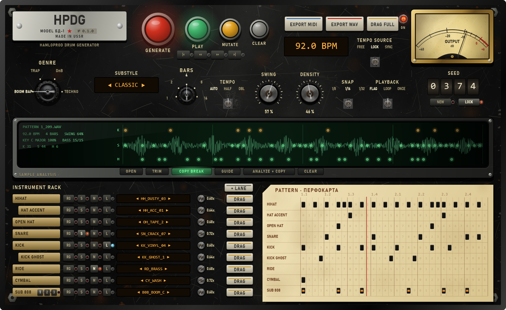

# ТЗ: скин «СССР / Black Steel» для HPDG (к релизу)

Владелец, 2026-10-25: новый интерфейс HPDG в советской стилистике, в одной серии с модулями HamloProd
(HamloComp, HamloVerb, HamloEcho, HamloMag … из HPEQ): ручки, тумблеры, лампы, стрелочные приборы,
ЭЛТ-экран. Целевой вид — макет ниже (нарисован настоящими функциями отрисовки HPEQ и ассетами владельца,
то есть это не набросок, а то, как должно выглядеть).

Файлы в этой папке:
- `hpdg_soviet_skin_mockup.png` — целевой вид, 1600 × 980.
- `mockup_renderer_reference.cpp` — код, которым нарисован макет (координаты, размеры, цвета, порядок
  слоёв, вспомогательные `pushButton`, `key`, `miniKey`, `selector`, `knob`, `threeWay`, перфокарта).
  Это образец, а не готовый компонент: он рисует статичную картинку.

## 0. Правила

- **Генерацию, звук, анализ, MIDI/WAV-экспорт и состояние не трогать.** Это только UI. Правила
  `docs/RULES.md` (генерация) остаются в силе; ни одно изменение не должно менять результат генерации.
- **Не ломать существующие скины.** В HPDG уже есть `Skin` (Sketch / Steel / Dark, `SketchTheme.h`,
  кнопка SKIN). Добавить четвёртый скин **`Soviet`** («СССР») и сделать его скином по умолчанию для новых
  установок; сохранённый выбор пользователя уважать. Переключение — как сейчас (при повторном открытии окна).
- Все действия, хоткеи, drag-and-drop в DAW, подсказки, режим ADV / COMPACT, Sub808 piano roll, Style Lab,
  Update-кнопка должны работать в новом скине так же, как в старых.
- Никаких аллокаций/загрузок картинок в `paint()` на каждый кадр: картинки грузятся один раз (кэш),
  статичные слои (сталь, гравировка, шкалы) рисуются в кэш-изображение при `resized()`.

## 1. Откуда брать стиль и ассеты (всё уже есть в HPEQ)

| Что | Где (репозиторий HPEQ, `D:\HPEQ`) |
|---|---|
| Функции отрисовки Black Steel | `Source/UI/BlackSteel.h/.cpp` — `panel` (сталь с износом, болты), `nameplate`, `engraved`, `knobScale`, `brassKnob` (картинки ручек + указатель), `lever` (тумблер ТП1-2), `lamp`, `lcdWindow/lcdText`, `meterFace/meterNeedle` (стрелочный прибор), `crtBezel/crtBegin/crtEnd/crtButton/glow/glowDot/crtText` (ЭЛТ), `scratches` (процарапанные рисунки) |
| Ассеты владельца (ручки, указатели, шкала, тумблеры, лампы, кнопка) | `docs/fx-addon/assets/soviet_hardware_pack/` (README.md + PNG) |
| Процарапанные советские картинки | `Assets/scratches/ussr_00..23.png` |
| Как встроены в бинарник | `CMakeLists.txt`: `juce_add_binary_data(HPEQ_Assets …)` — повторить в HPDG (`HPDG_Assets`), чтобы ничего не лежало рядом с `.vst3` |
| Примеры готовых страниц | `Source/UI/HamloMagPanel.cpp` (бобины, переключатель-«куриная лапа», рычажки), `HamloEchoPanel.cpp` / `HamloVerbPanel.cpp` (ЭЛТ, ручки), `HamloFaderPanel.cpp` (фейдер, кнопка MATCH) |

Скопировать `BlackSteel.*` в HPDG (например `Source/UI/Soviet/`), поменять namespace на HPDG, подключить
ассеты. Шрифты: Bahnschrift (гравировка, Windows) и Consolas (ЖК/ЭЛТ), как в HPEQ — ничего не скачивать.

## 2. Что во что превращается (по зонам макета)

### 2.1 Шапка
| Сейчас | В скине «СССР» |
|---|---|
| Надпись HPDG + версия | Шильдик `nameplate`: **HPDG · MODEL БД-1 · № <версия> · MADE IN USSR**, под ним гравировка HAMLOPROD DRUM GENERATOR |
| Generate Pattern | Большая **красная** грибовидная кнопка с подсветкой (самая заметная на панели) |
| Play | **Зелёная** кнопка-лампа; горит, пока идёт воспроизведение |
| Mutate | Жёлтая кнопка поменьше |
| Clear All | Серая кнопка |
| `|< << >> >|` | Ряд маленьких клавиш под Play |
| Export Full / Export Loop WAV / Drag Full | «Клавиши» как у пишущей машинки/пульта (светлые, с цветной полосой): EXPORT MIDI (синяя), EXPORT WAV (красная), DRAG FULL (латунная). Drag-жест сохраняется |
| BPM (поле) + Lock + Sync | Янтарный **ЖК-индикатор** «92.0 BPM» (клик — ввод, колесо/перетаскивание — изменение) и трёхпозиционный тумблер **TEMPO SOURCE: FREE / LOCK / SYNC** |
| Output Vol | Стрелочный прибор **OUTPUT** (уровень выхода) + ручка громкости; лампа ON |
| ADV / COMPACT, SKIN, Presets, Max, Update, Start play with DAW | Маленькие клавиши/тумблеры в свободном месте шапки (не на макете — разместить аккуратно, справа от шильдика или под прибором) |

### 2.2 Параметры генерации
| Сейчас | В скине «СССР» |
|---|---|
| Genre (комбо) | Галетный **переключатель** с бакелитовой «куриной лапой»: BOOM BAP / TRAP / DnB / TECHNO |
| Substyle (комбо) | ЖК-окно с ◀ ▶ (клик по названию — список) |
| Bars | Малый галетный переключатель 1 / 2 / 4 / 8 / 16 |
| Tempo Mode | Трёхпозиционный тумблер (подписи по реальным режимам HPDG) |
| Swing, Density (и Hat FX density, Velocity, Timing, Humanize в ADV) | Латунные ручки `brassKnob` со шкалой `knobScale` и значением под ручкой |
| Snap, Playback | Трёхпозиционные тумблеры (если вариантов больше трёх — галетный переключатель) |
| Seed + Seed Lock | **Механический счётчик** (барабанчики с цифрами), клавиши NEW и LOCK с лампой |

### 2.3 Sample Analysis
ЭЛТ-экран во всю ширину (`crtBezel/crtBegin/crtEnd`): слева текст (имя файла, BPM, такты, свинг, тональность,
бас, K/S/H), справа волна семпла зелёным люминофором и удары **K (янтарные) / S / H (зелёные)** точками
`glowDot` на трёх строках; вертикальные линии тактов. Кнопки на рамке экрана (`crtButton`): OPEN, TRIM,
режим (COPY BREAK / GUIDE — горит выбранный), ANALYZE + COPY, CLEAR; ручка Quantize, «Play w/ HPDG» —
маленький тумблер. Drag-and-drop файла на экран работает как сейчас; Trim-редактор — в том же стиле.

### 2.4 Instrument Rack
Каждая дорожка — строка «пульта»:
- латунная табличка с названием (вложенные дорожки — с отступом, как сейчас);
- RG — маленькая клавиша; **S / M / L** — клавиши с лампой (S янтарная, M красная, L голубая), горят при включении;
- семпл — ЖК-окно с ◀ ▶ (клик — браузер семплов);
- громкость/сила — маленькая латунная ручка + значение;
- DRAG (и WAV) — клавиша, drag-жест сохраняется;
- Sub808: клавиши **1 / 2 / 3**, ± транспонирование, тональность/лад — в том же стиле;
- «+ LANE» — клавиша над рэком; меню `...` — маленькая клавиша.

### 2.5 Pattern — «перфокарта»
Сетка паттерна — **перфокарта**: кремовая бумага со скошенным углом и пятнами, коричневые типографские
линии и номера долей (1.1, 1.2 …), удары — **пробитые отверстия** (видна тёмная сталь под картой), у Sub808 —
отверстия с янтарной подсветкой; курсор воспроизведения — красная линия. Редактирование мышью, выделение,
зум, высота дорожек, скролл — как в текущем `GridEditorComponent` (меняется только отрисовка). VST3 GRID
(lite) — в том же стиле.

## 3. Порядок работы
1. Перенести `BlackSteel` + ассеты в HPDG, собрать, нарисовать пустую стальную панель в новом скине.
2. Шапка и параметры генерации (2.1–2.2).
3. Sample Analysis (2.3).
4. Rack (2.4), затем Pattern (2.5).
5. Подсказки, хоткеи, ADV/COMPACT, Sub808 piano roll, Style Lab, диалоги — пройти всё в новом скине.
6. Скриншоты каждого шага (до/после), сверка с макетом.

## 4. Приёмка
- Окно HPDG в скине «СССР» визуально совпадает с макетом (расположение, материалы, цвета, шрифты).
- Все функции работают как в старом скине: генерация, Play/транспорт, мутация, экспорт и drag в DAW,
  анализ семпла, редактирование сетки, Sub808, хоткеи, undo/redo. Старые скины не изменились.
- Генерация побитово та же (те же сиды → те же паттерны), существующие тесты HPDG зелёные.
- UI не нагружает: полная перерисовка окна < 16 мс, без аллокаций в `paint()` на каждом кадре,
  анимации (лампы, стрелка прибора, курсор) — таймер 30 Гц.
- Масштабирование окна: всё рисуется в своих координатах и масштабируется (как страницы HPEQ).
- Отчёт со скриншотами в `docs/ui-soviet/`.
